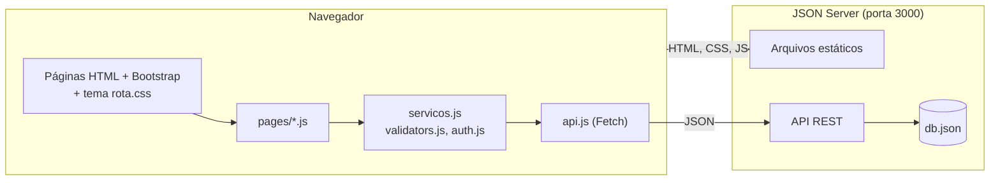
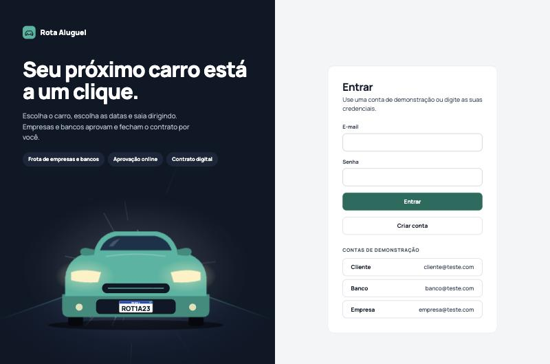
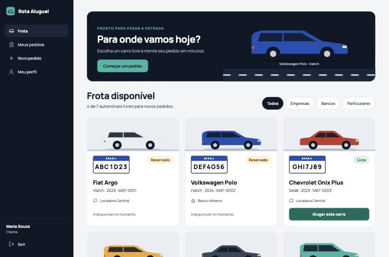
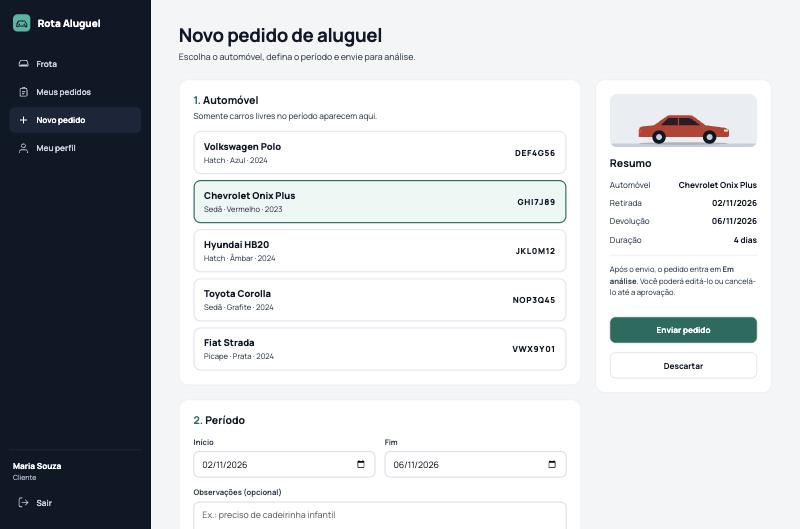
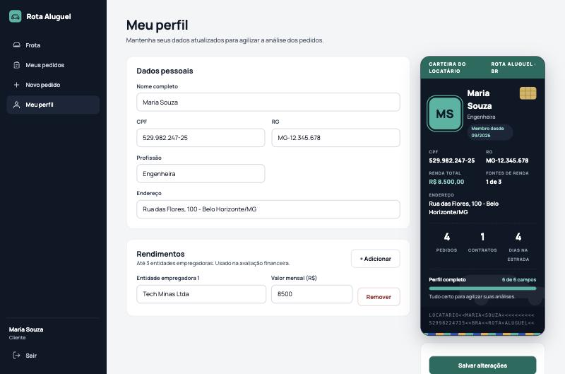
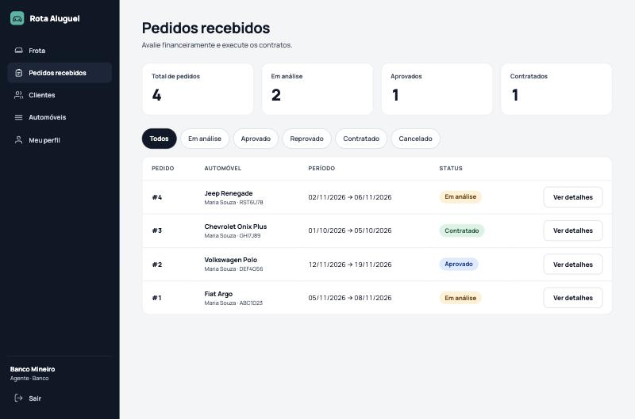
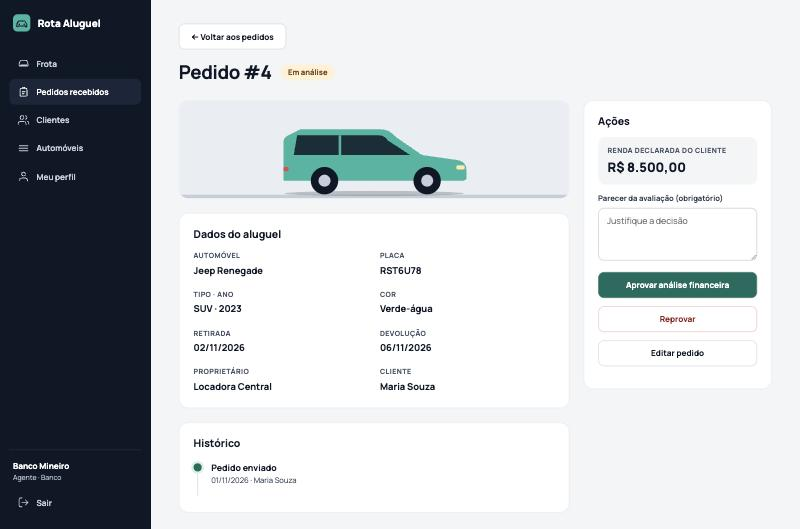
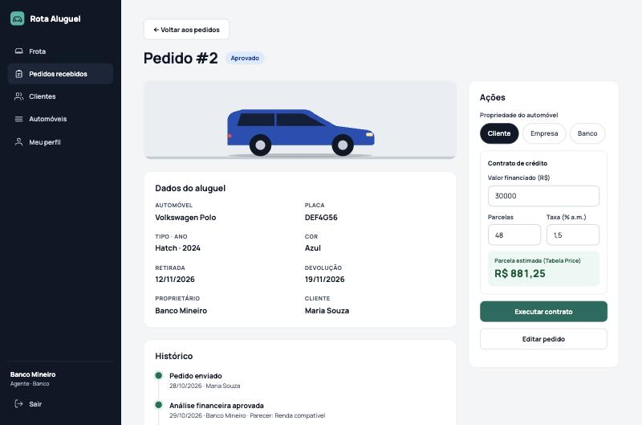
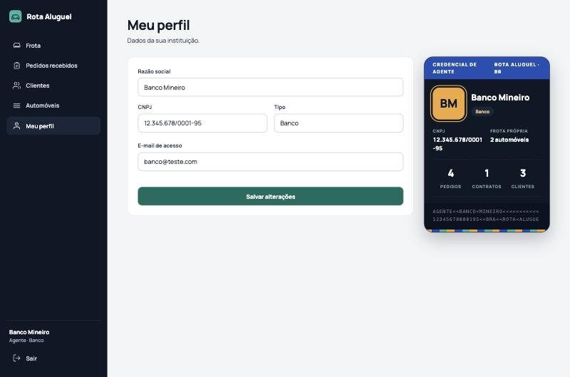
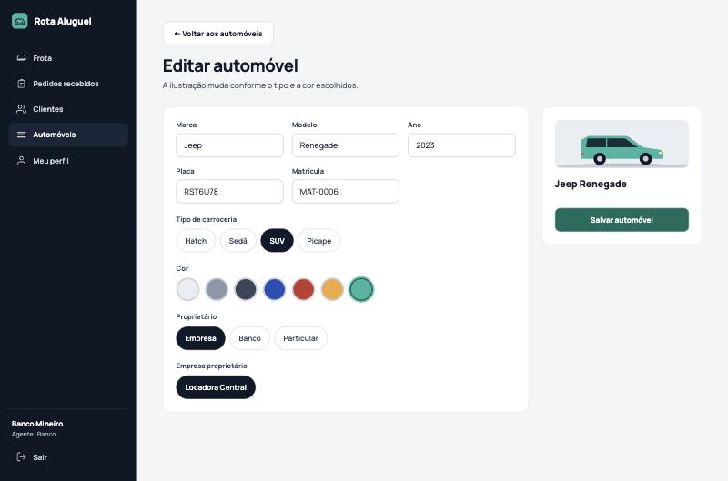

<!-- README baseado no template do Prof. Dr. João Paulo Aramuni (TEMPLATES/template_README.md) -->

# 🚗 Rota Aluguel: Sistema de Aluguel de Carros

> [!NOTE]
> Protótipo web para gestão de pedidos de aluguel de automóveis. Clientes escolhem um carro da frota, definem o período e acompanham o pedido. Agentes (empresas e bancos) avaliam financeiramente, executam o contrato e, no caso dos bancos, concedem crédito.

[](#)


**Disciplina:** Desenvolvimento de Interfaces Web (DIW) · 2º período · PUC Minas
**Professor:** João Paulo Carneiro Aramuni · **Atividade:** Laboratório 02 (15 pontos)

---

## 📚 Índice
- [Sobre o Projeto](#-sobre-o-projeto)
- [Funcionalidades Principais](#-funcionalidades-principais)
- [Tecnologias Utilizadas](#-tecnologias-utilizadas)
- [Arquitetura](#-arquitetura)
- [Modelagem (UML)](#-modelagem-uml)
- [Instalação e Execução](#-instalação-e-execução)
- [Estrutura de Pastas](#-estrutura-de-pastas)
- [Demonstração](#-demonstração)
- [Testes](#-testes)
- [Decisões e Limitações](#-decisões-e-limitações)
- [Documentações utilizadas](#-documentações-utilizadas)
- [Autores](#-autores)

---

## 📝 Sobre o Projeto

O sistema apoia a gestão de aluguéis de automóveis pela Internet e só pode ser usado após **cadastro prévio**. Dois perfis de usuário interagem com o mesmo servidor central:

- **Clientes** (usuários individuais) introduzem, modificam, consultam e cancelam pedidos de aluguel.
- **Agentes** (empresas e bancos) modificam e avaliam pedidos. Depois de uma análise financeira positiva, executam o contrato. Os bancos vinculam um **contrato de crédito** ao aluguel.

Do contratante guardam-se RG, CPF, nome, endereço, profissão e as entidades empregadoras com os rendimentos (**máximo 3**). Do automóvel guardam-se matrícula, ano, marca, modelo e placa, além da carroceria e da cor usadas na ilustração. Conforme o tipo de contrato, o automóvel é registrado como propriedade do **cliente, de uma empresa ou de um banco**.

A interface segue o protótipo **Rota Aluguel**: barra lateral escura, cards com ilustração dos carros, placa Mercosul, "Carteira do locatário" e "Credencial de agente".

---

## ✨ Funcionalidades Principais

- 🔐 **Entrar e criar conta**, com contas de demonstração e cadastro rápido. O cliente completa o perfil depois.
- 🚘 **Frota**: cards com ilustração, placa, proprietário e selo Livre/Reservado, com filtro por proprietário.
- 📝 **Pedidos**: escolher um carro livre no período, ver o resumo com a duração, editar enquanto "Em análise", cancelar e acompanhar o histórico.
- 📊 **Painel de pedidos**: indicadores por status, filtro por status e tabela.
- 💰 **Avaliação financeira**: o agente vê a renda declarada e aprova ou reprova com parecer obrigatório.
- 📄 **Execução de contrato**: define a propriedade do automóvel (cliente, empresa ou banco). O banco informa o crédito e vê a parcela estimada pela Tabela Price.
- 👤 **CRUD de clientes** (agente) e **perfil do cliente** com a carteira do locatário: progresso do perfil, renda, pedidos, contratos e dias na estrada.
- 🏦 **Perfil do agente** com a credencial: frota própria, pedidos, contratos e clientes.
- 🚗 **CRUD de automóveis** com prévia ao vivo da carroceria e da cor.

### Fluxo de status do pedido

`Em análise` → `Aprovado` ou `Reprovado` → `Contratado`. O cliente pode `Cancelar` um pedido em análise ou aprovado.

---

## 🛠 Tecnologias Utilizadas

| Camada | Tecnologia |
|--------|-----------|
| Estrutura e lógica | HTML5, CSS3, JavaScript (módulos ES) |
| Interface | Bootstrap 5.3.3 (grade, utilitários, modal) + tema próprio `css/rota.css` |
| Tipografia | Manrope (Google Fonts) |
| API e persistência | JSON Server 0.17.4 (API REST simulada a partir do `db.json`) |
| Comunicação | Fetch API |
| Ambiente | Node.js 18+ e npm |

---

## 🏗 Arquitetura

O sistema é dividido nos dois subsistemas pedidos pelo enunciado:

1. **Construção dinâmica das páginas** (`src/js/pages`, `ui.js`, `carros.js`): as páginas HTML são esqueletos que o JavaScript preenche com os dados da API, de acordo com o perfil do usuário.
2. **Gestão de pedidos e contratos** (`servicos.js`, `validators.js`, `auth.js`, `api.js`): regras de negócio, disponibilidade por período, validações e acesso à API REST.

O JSON Server serve tanto a API (`/clientes`, `/pedidos`...) quanto os arquivos estáticos (`--static ./src`), então tudo roda em uma única origem e porta.



### 📐 Modelagem (UML)

Todas as versões dos modelos estão no repositório, em Mermaid (renderizam direto no GitHub):

| Modelo | v1 (inicial) | v2 (alinhado ao código) | v3 (protótipo Rota Aluguel) |
|--------|--------------|-------------------------|-----------------------------|
| Casos de uso | [v1](docs/v1/01-casos-de-uso.md) | sem mudanças | [v3](docs/v3/01-casos-de-uso.md) |
| Histórias do usuário | [v1](docs/v1/02-historias-de-usuario.md) | sem mudanças | [v3](docs/v3/02-historias-de-usuario.md) |
| Classes e estados | [v1](docs/v1/03-diagrama-de-classes.md) | [v2](docs/v2/03-diagrama-de-classes.md) | [v3](docs/v3/03-diagrama-de-classes.md) |
| Pacotes (visão lógica) | [v1](docs/v1/04-diagrama-de-pacotes.md) | [v2](docs/v2/04-diagrama-de-pacotes.md) | [v3](docs/v3/04-diagrama-de-pacotes.md) |
| Componentes | [v1](docs/v1/05-diagrama-de-componentes.md) | [v2](docs/v2/05-diagrama-de-componentes.md) | [v3](docs/v3/05-diagrama-de-componentes.md) |

📋 **Comparação modelo × código e justificativa de cada mudança:** [docs/CHANGELOG-modelos.md](docs/CHANGELOG-modelos.md)

---

## 🔧 Instalação e Execução

### Pré-requisitos

- **Node.js** v18 ou superior e **npm**
- Navegador moderno e conexão com a Internet (Bootstrap e a fonte Manrope vêm de CDN)

### Instalação

```bash
npm install
```

### Execução

```bash
npm start
```

Abra **http://localhost:3000** no navegador. A API fica em `http://localhost:3000/pedidos`, `/clientes` etc.

> Para voltar aos dados iniciais, restaure o `db.json` com `git checkout db.json`.

---

## 📂 Estrutura de Pastas

```
.
├── db.json                      # "banco de dados" do JSON Server (dados iniciais)
├── package.json
├── docs/
│   ├── v1/  v2/  v3/            # versões dos modelos UML
│   └── CHANGELOG-modelos.md     # o que mudou entre as versões e por quê
└── src/
    ├── login.html, cadastro.html, frota.html, pedidos.html, pedido-form.html,
    │   pedido-detalhe.html, clientes.html, cliente-form.html, perfil-agente.html,
    │   automoveis.html, automovel-form.html, index.html
    ├── css/rota.css             # tema do protótipo sobre o Bootstrap
    └── js/
        ├── api.js               # Fetch API
        ├── auth.js              # sessão e perfis
        ├── servicos.js          # regras de negócio
        ├── validators.js        # CPF, CNPJ, placa, e-mail, automóvel
        ├── ui.js                # barra lateral, avisos, chips, badges, formatação
        ├── carros.js            # ilustração SVG dos carros e placa Mercosul
        └── pages/*.js           # um controlador por página
```

---

## 🎬 Demonstração

### Aplicação Web

| Entrar | Frota (cliente) |
| :---: | :---: |
|  |  |
| **Novo pedido** | **Carteira do locatário** |
|  |  |
| **Pedidos recebidos (agente)** | **Avaliação financeira** |
|  |  |
| **Executar contrato com crédito** | **Credencial de agente** |
|  |  |
| **Automóvel com prévia** | |
|  | |

### Contas de teste

Usuários de teste (senha de todos: `123456`). Os três primeiros aparecem como botões na tela de login.

| Perfil | E-mail | O que pode fazer |
|--------|--------|------------------|
| Cliente | `cliente@teste.com` (Maria Souza) | Criar, editar e cancelar pedidos; editar o perfil |
| Agente (banco) | `banco@teste.com` | Avaliar, modificar, executar contrato com crédito, gerenciar clientes e automóveis |
| Agente (empresa) | `empresa@teste.com` | O mesmo, sem crédito |
| Cliente | `joao@teste.com`, `ana@teste.com` | Outros locatários para testar |

**Roteiro sugerido:**

1. Entre como **Cliente** → **Frota** → "Alugar este carro" num carro livre → ajuste as datas → **Enviar pedido**.
2. Saia e entre como **Banco** → **Pedidos recebidos** → **Ver detalhes** → escreva o parecer → **Aprovar análise financeira**.
3. Em **Executar contrato**, escolha a propriedade do automóvel, ajuste o crédito e confirme.
4. Volte ao cliente: o pedido aparece como "Contratado" e a carteira do locatário soma o contrato.

---

## 🧪 Testes

Os testes foram manuais, com o app rodando no navegador e o JSON Server ativo. Foram exercitados:

- **Validações:** CPF e CNPJ inválidos ou duplicados, mais de 3 rendimentos, e-mail duplicado, senha curta, placa inválida, datas no passado e fim antes do início.
- **Disponibilidade:** conflito de datas com outro pedido ativo e liberação do carro em outro período.
- **Perfis:** agente não cria pedido, cliente não edita pedido de outro cliente, apenas bancos concedem crédito.
- **Fluxo de status:** avaliar sem parecer, contratar sem aprovação, cancelar pedido contratado e editar pedido contratado são bloqueados.
- **Integridade:** não exclui cliente com pedido ativo nem automóvel com pedidos; a exclusão de cliente remove também o login.
- **Cálculo:** R$ 30.000,00 em 48x a 1,5% a.m. = R$ 881,25; em 24x = R$ 1.497,72.
- **Layout:** 1360×900 (tamanho do protótipo) e celular (375 px), sem rolagem horizontal.

---

## ⚠️ Decisões e Limitações

- **Autenticação simulada:** as senhas ficam em texto puro no `db.json` e a sessão no `sessionStorage`. Isso é aceitável apenas porque o JSON Server é uma API simulada para fins acadêmicos.
- **JSON Server 0.17:**
  - O `_expand=automovel` não funciona, porque a biblioteca de plural gera `automovels`. Por isso o automóvel é anexado ao pedido no código.
  - Os campos `...Id` nunca são gravados como `null`, porque isso quebra os `DELETE`.
- **Protótipo × requisitos:** onde o protótipo não cobria um requisito do enunciado, a funcionalidade foi mantida no mesmo estilo visual:
  - o agente modifica pedidos;
  - o agente cadastra um cliente com e-mail e senha de acesso;
  - o contrato pode ter como proprietário uma instituição específica.

---

## 📖 Documentações utilizadas

- [Bootstrap 5](https://getbootstrap.com/docs/5.3/)
- [JSON Server](https://github.com/typicode/json-server/tree/v0.17.4)
- [Fetch API (MDN)](https://developer.mozilla.org/pt-BR/docs/Web/API/Fetch_API)
- [Diagrama de Pacotes](https://www.uml-diagrams.org/package-diagrams.html)

---

## 👥 Autores

- Lucas Rodrigues Givisiez Melo - PUC Minas, Ciência da computação
