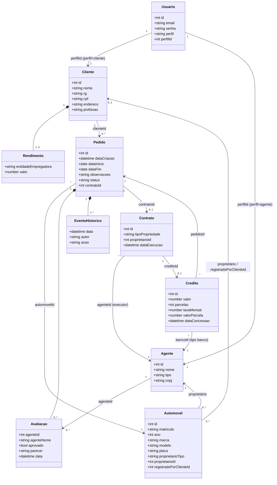
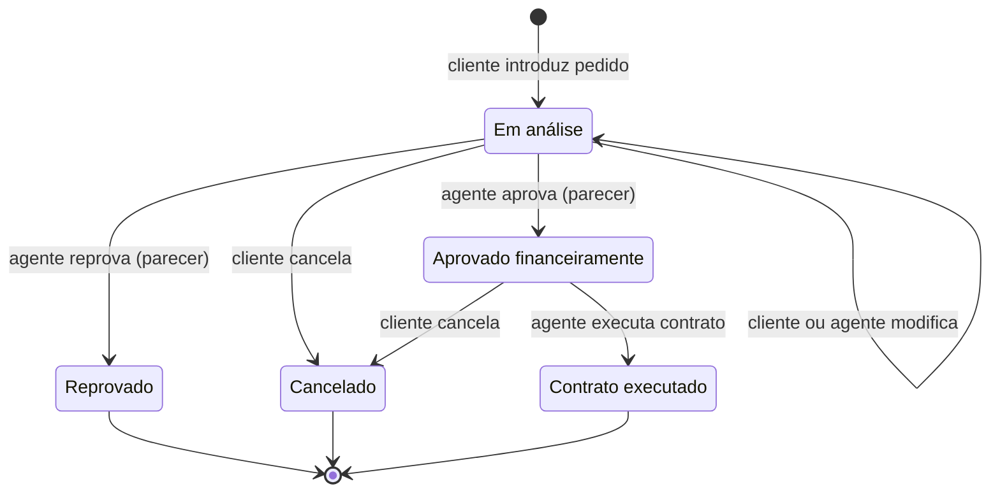

# Diagrama de Classes (v2 - alinhado ao código)

Os atributos correspondem aos campos reais do `db.json`. As mudanças em relação à v1 estão em [`../CHANGELOG-modelos.md`](../CHANGELOG-modelos.md).

## Máquina de estados do Pedido

## Valores permitidos

| Campo | Valores |
|-------|---------|
| `Usuario.perfil` | `cliente`, `agente` |
| `Agente.tipo` | `empresa`, `banco` |
| `Automovel.proprietarioTipo` | `cliente`, `empresa`, `banco` ou `null` (a definir) |
| `Contrato.tipoPropriedade` | `cliente`, `empresa`, `banco` |
| `Pedido.status` | Em análise, Aprovado financeiramente, Reprovado, Contrato executado, Cancelado |
