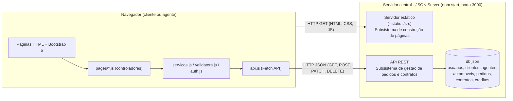

# Diagrama de Componentes (v2 - alinhado ao código)

Interfaces:

| Interface | Provida por | Consumida por |
|-----------|-------------|---------------|
| Arquivos estáticos | Servidor estático do JSON Server | Navegador |
| `/usuarios`, `/clientes`, `/agentes`, `/automoveis`, `/pedidos`, `/contratos`, `/creditos` | API REST do JSON Server | `api.js` |
| Funções de domínio (`salvarPedido`, `avaliarPedido`, `executarContrato`...) | `servicos.js` | `pages/*.js` |
