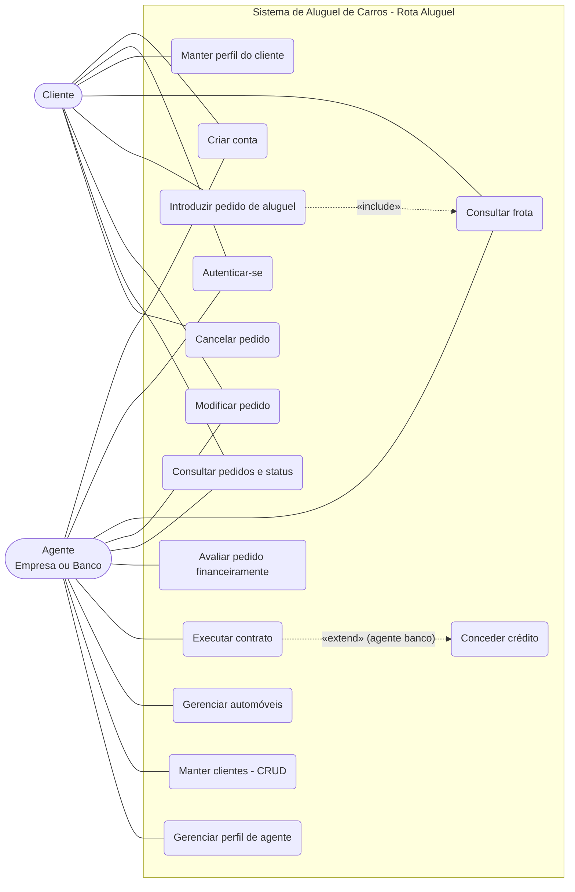

# Diagrama de Casos de Uso (v3)

Mudanças em relação à v1: entram **Consultar frota**, **Gerenciar perfil de agente** e o cadastro rápido. O cliente passa a escolher o carro da frota (não informa mais um carro próprio), e a disponibilidade depende do período.

