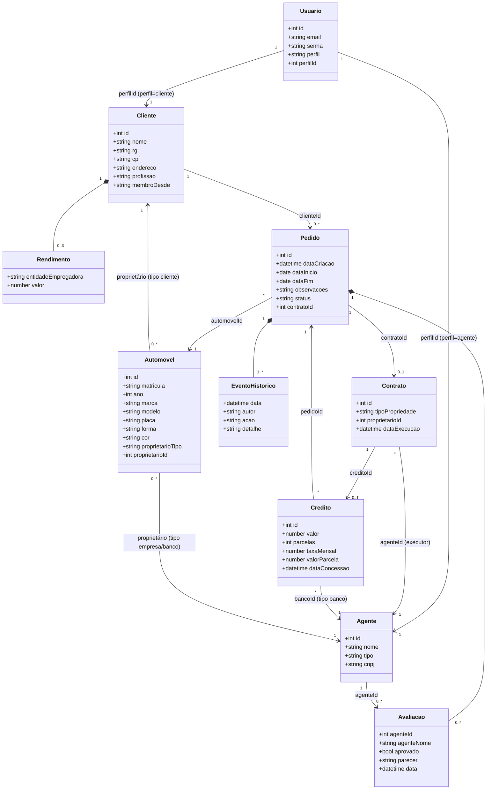
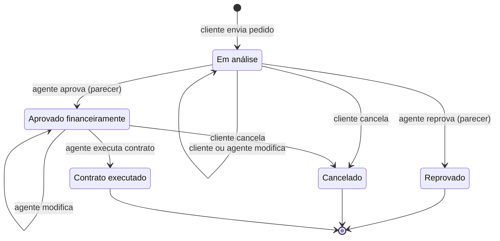

# Diagrama de Classes (v3 - alinhado ao código)

Os atributos correspondem aos campos do `db.json`. As mudanças estão em [`../CHANGELOG-modelos.md`](../CHANGELOG-modelos.md).

## Valores permitidos

| Campo | Valores |
|-------|---------|
| `Usuario.perfil` | `cliente`, `agente` |
| `Agente.tipo` | `empresa`, `banco` |
| `Automovel.forma` | `hatch`, `sedan`, `suv`, `picape` |
| `Automovel.cor` | hexadecimal da paleta: Branco, Prata, Grafite, Azul, Vermelho, Âmbar, Verde-água |
| `Automovel.proprietarioTipo` / `Contrato.tipoPropriedade` | `cliente`, `empresa`, `banco` |
| `Pedido.status` | Em análise, Aprovado financeiramente, Reprovado, Contrato executado, Cancelado (na tela: Em análise, Aprovado, Reprovado, Contratado, Cancelado) |

`Pedido.contratoId` e `Contrato.creditoId` ficam **ausentes** (não `null`) enquanto não existem. Veja o changelog.

## Máquina de estados do Pedido

