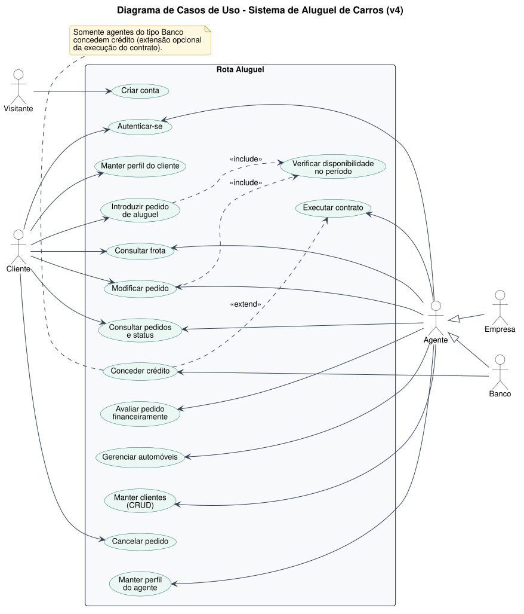
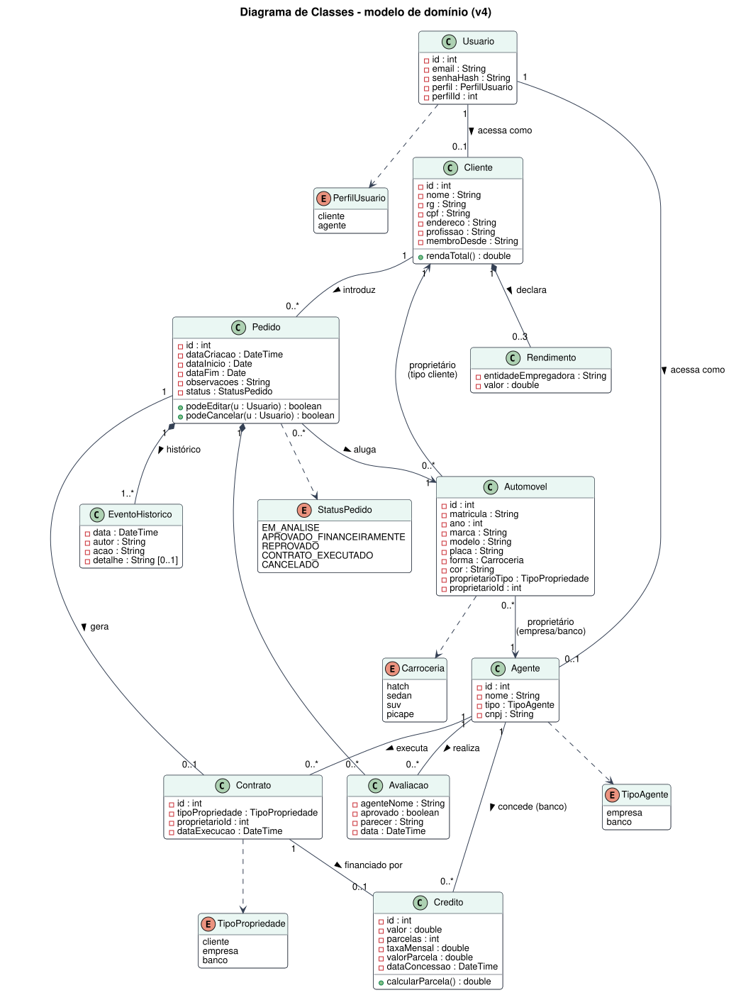
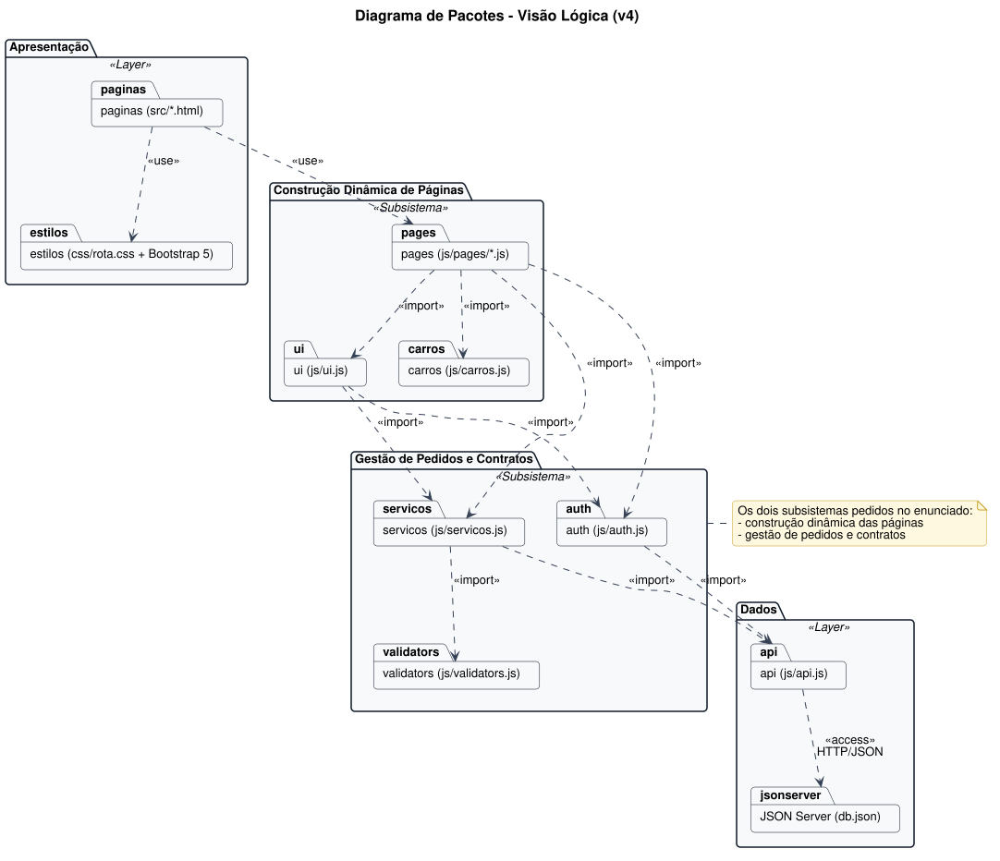
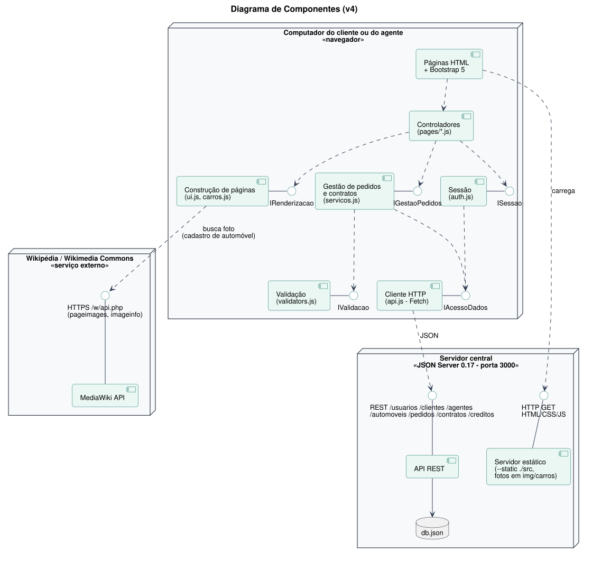
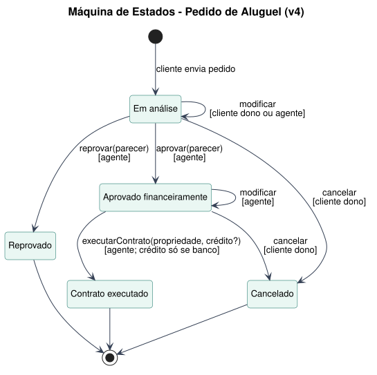
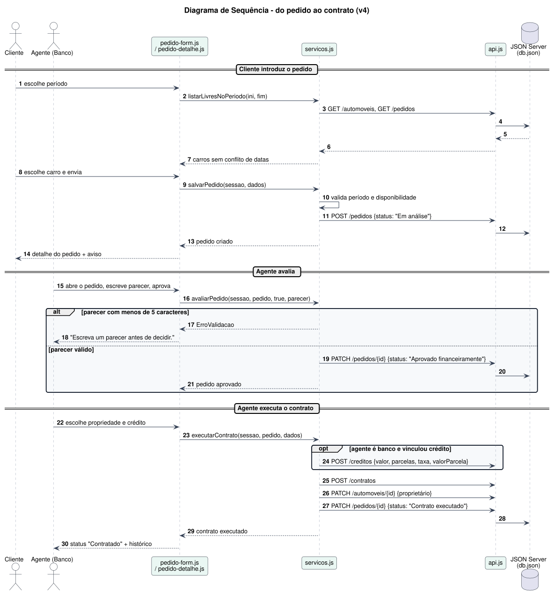

# Modelos v4: notação UML (PlantUML)

Nesta versão os diagramas foram redesenhados em **notação UML de verdade** com o [PlantUML](https://plantuml.com). As versões anteriores (v1 a v3, em Mermaid) foram mantidas para mostrar a evolução. O motivo de cada mudança está em [`../CHANGELOG-modelos.md`](../CHANGELOG-modelos.md#v3--v4).

Cada diagrama tem o código-fonte (`.puml`) e a imagem gerada (`.svg` e `.png`). Para gerar de novo:

```bash
brew install plantuml
cd docs/v4 && plantuml -tsvg -charset UTF-8 0*.puml
```

| Diagrama | Fonte | O que mostra |
|----------|-------|--------------|
| [Casos de uso](#casos-de-uso) | [01-casos-de-uso.puml](01-casos-de-uso.puml) | Atores (com Empresa e Banco como especializações de Agente), fronteira do sistema, «include» e «extend» |
| [Histórias do usuário](02-historias-de-usuario.md) | — | HU01 a HU15 com critérios de aceitação |
| [Classes](#classes) | [03-diagrama-de-classes.puml](03-diagrama-de-classes.puml) | Visibilidade, tipos, multiplicidades, composições e enumerações |
| [Pacotes](#pacotes) | [04-diagrama-de-pacotes.puml](04-diagrama-de-pacotes.puml) | Pacotes UML com dependências «import», «use» e «access» |
| [Componentes](#componentes) | [05-diagrama-de-componentes.puml](05-diagrama-de-componentes.puml) | Componentes, interfaces fornecidas (pirulito) e requeridas, nós de implantação |
| [Estados](#estados-do-pedido) | [06-diagrama-de-estados.puml](06-diagrama-de-estados.puml) | Ciclo de vida do pedido, com eventos e guardas |
| [Sequência](#sequência) | [07-diagrama-de-sequencia.puml](07-diagrama-de-sequencia.puml) | Fluxo do pedido ao contrato, com fragmentos `alt` e `opt` |

## Casos de uso


## Classes


## Pacotes


## Componentes


## Estados do pedido


## Sequência

